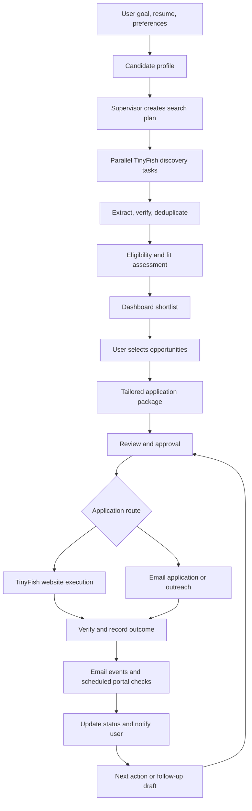

# Agentic Internship Platform — TinyFish Architecture

Build this as a **goal-driven internship copilot**: the user sets their career preferences, and a coordinated agent system discovers opportunities, prepares applications, executes approved actions, and tracks what happens afterward.

**TinyFish should power the system’s interaction with websites.** The application should manage planning, user context, approvals, and application history around it.

This is a proposed architecture based on TinyFish’s documentation, rather than a claim that TinyFish provides the entire platform.

## 1. Where TinyFish Fits

| TinyFish capability | Use in the platform |
|---|---|
| **Search API** | Discover internship listings and company career pages through keyword searches. |
| **Fetch API** | Read known listing URLs and extract their content. |
| **Web Agent API** | Navigate sites, use filters, inspect listings, and perform application workflows using natural-language goals. |
| **Browser API** | Control specific steps through Playwright/CDP when precise browser behavior is needed. |
| **Monitor** | Watch public listings for changes or search topics for new opportunities. |

These capabilities are documented in the [TinyFish API overview](https://docs.tinyfish.ai/) and [Monitor documentation](https://docs.tinyfish.ai/monitor).

For discovery, use **Search → Fetch → Web Agent when interaction is required**. This keeps browser automation focused on tasks that need it.

## 2. Proposed Agents

These are logical roles. Several can run inside the same service rather than requiring a separate deployed system for every agent.

| Agent | Responsibility | Tools and output | Agentic pattern |
|---|---|---|---|
| **1. Supervisor / Orchestrator** | Convert the user’s goal into tasks, choose specialist agents, manage dependencies, and recover from failures. | Workflow state, task queue, specialist tools → execution plan. | **Plan-and-execute**, tool routing |
| **2. Candidate Profile Agent** | Structure skills, projects, education, availability, location, and preferences. Identify missing information. | Resume parser, user answers, profile database → verified candidate profile. | **Long-term memory**, context engineering |
| **3. Opportunity Discovery Agent** | Expand keywords, choose sources, search multiple websites, and collect listings. | TinyFish Search, Fetch, Web Agent → opportunities with source URLs. | **Parallel fan-out / fan-in**, bounded exploration |
| **4. Verification and Matching Agent** | Check eligibility, listing freshness, duplicates, and fit. Explain why each opportunity matches. | Source evidence, candidate profile → eligible shortlist and explanations. | **Grounding**, evaluator–optimizer |
| **5. Application Preparation Agent** | Tailor resumes, cover letters, and screening answers using the candidate’s actual experience. | Candidate evidence, job description, document generator → application package. | **RAG**, constrained generation |
| **6. Application Execution Agent** | Complete supported website forms or submit approved email applications. Capture confirmation evidence. | TinyFish Web Agent/Browser, mail API → submission result. | **Tool use**, human-in-the-loop |
| **7. Outreach Agent** | Research companies, identify published recruiting contacts, and draft invited or cold outreach. | TinyFish Search/Fetch, mail API → personalized draft and outreach record. | Research–compose–review |
| **8. Response and Status Agent** | Interpret employer emails and portal updates, associate them with applications, and suggest next actions. | Mail events, authenticated TinyFish checks → evidence-backed status updates. | **Event-driven agents**, state reconciliation |

Use a **scheduler and notification service** for deadline reminders. Sending a reminder at a known time is ordinary software logic; interpreting an ambiguous employer reply benefits from an agent.

## 3. End-to-End Flow



### Step 1: Capture the User’s Goal and Autonomy Preferences

For example:

> Find remote backend internships using Python, with a stipend of at least ₹15,000 per month. Prepare applications for suitable roles and ask me before submitting.

Store hard constraints separately from preferences. “Must be remote” is a filter; “prefer fintech” affects ranking.

### Step 2: Create a Bounded Search Plan

The supervisor expands “backend internship” into relevant queries such as “Python intern,” “API development intern,” and “software engineering internship.”

It assigns discovery tasks across sources with limits on pages, runtime, and retries. This is **fan-out / fan-in**: search independently, then consolidate results.

### Step 3: Extract and Verify Opportunities

Store a consistent record:

```text
company, role, description, required_skills,
location, work_mode, eligibility,
stipend_amount, currency, payment_period,
deadline, deadline_timezone,
source_url, application_url, retrieved_at
```

Preserve evidence for important fields. An absent deadline means “not specified”; an absent stipend means “unknown,” rather than “unpaid.”

Deduplicate using the employer, role, location, requisition ID where available, and canonical application URL.

### Step 4: Match and Show the Shortlist

Apply eligibility filters before scoring fit. Let users sort independently by deadline, pay, or relevance.

Show explanations such as:

> Matches your Python and FastAPI projects. Requires three months of availability, which you have confirmed. Docker experience is requested but missing from your profile.

Normalize payment periods and currencies before comparing pay, while preserving the original amounts.

### Step 5: Prepare the Application Package

Retrieve relevant candidate projects and experience, then tailor the resume, cover letter, and screening answers.

This is **retrieval-augmented generation (RAG)**: generation grounded in stored evidence. Never invent skills, employment, or achievement numbers.

A verifier checks the package against the candidate profile and flags unanswered factual questions.

### Step 6: Review, Approve, and Execute

Present the exact documents, answers, destination, and email recipient for approval. Record approval against that package version.

TinyFish documents both basic and multi-step [form filling and submission](https://docs.tinyfish.ai/examples/form-filling). Test uploads and authentication on each supported platform before promising end-to-end application support.

Build approval enforcement into the backend or browser controller. A prompt saying “do not submit yet” should not be the only control. Revalidate the destination and required fields before execution.

### Step 7: Verify the Outcome

Capture a confirmation message, application ID, receipt email, or portal record.

**A completed browser run does not automatically mean the application was submitted.** Keep uncertain outcomes visible and reconcile them before retrying.

Track cold outreach separately: “outreach sent” should become “applied” only when there is evidence of an actual application.

### Step 8: Monitor and Trigger the Next Action

Use three monitoring paths:

- **Public listing changes:** TinyFish Monitor for closures, deadline changes, and new listings.
- **Private employer portals:** scheduled TinyFish runs using the user’s authenticated browser context.
- **Employer email:** Gmail or Outlook integrations.

TinyFish [Browser Context Profiles](https://docs.tinyfish.ai/key-concepts/browser-context-profiles) retain login state across runs, although sessions can expire and require reauthentication. Email changes can reach the backend through [Gmail push notifications](https://developers.google.com/workspace/gmail/api/guides/push) or [Microsoft Graph change notifications](https://learn.microsoft.com/en-us/graph/outlook-change-notifications-overview).

An interview invitation should create a notification and suggested reply. No response should remain “awaiting response,” rather than being interpreted as rejection.

## 4. Agentic Terminology

| Term | Meaning in this project |
|---|---|
| **Agent harness** | The runtime around agents: tools, permissions, memory, budgets, retries, and logs. |
| **Plan-and-execute** | The supervisor creates a plan; specialists execute its steps. |
| **ReAct** | An agent observes a page, chooses an action, uses a tool, and checks the result. Useful for browser navigation. |
| **Context engineering** | Give each agent only the relevant profile facts, listing evidence, and task history. |
| **Human-in-the-loop** | Pause the application workflow for user review or missing information. |
| **Durable execution** | Save workflow state so it can resume after a restart or approval delay. |
| **Event-driven orchestration** | Resume work when an email arrives, a deadline approaches, or a portal changes. |
| **Idempotency** | Prevent duplicate actions when jobs or events are retried. |
| **Observability and evals** | Trace agent actions and measure extraction accuracy, factual correctness, submission verification, and status accuracy. |

Idempotency needs special care for external submissions: use an application lock and action record, then check receipts or portal state after a timeout before retrying.

## 5. Suggested Implementation

Use **LangGraph for orchestration**, TinyFish for website tasks, a relational database for profiles and application state, document storage for resume versions, and a queue/scheduler for background work.

LangGraph supports stateful workflows, durable execution, streaming, and human review. See the [LangGraph documentation](https://docs.langchain.com/oss/python/langgraph/overview).

Keep authentication credentials separate from agent memory, isolate browser profiles by user, and treat webpage/email content as untrusted input rather than instructions to the agent.

## 6. MVP Build Order

1. **Discovery and matching:** a few supported sources, verified listings, deadline/pay sorting, and fit explanations.
2. **Application preparation:** tailored documents, screening answers, and review.
3. **Execution:** one well-tested website flow plus email applications, with verified receipts.
4. **Monitoring:** email classification, portal checks, reminders, and reviewed follow-ups.

## 7. Demonstration Flow

Show one complete loop:

**A user goal → TinyFish finds a suitable internship → agents prepare an application → the user approves → submission is verified → an employer reply updates the dashboard.**

This demonstrates agentic behavior through planning, action, observation, and adaptation.
