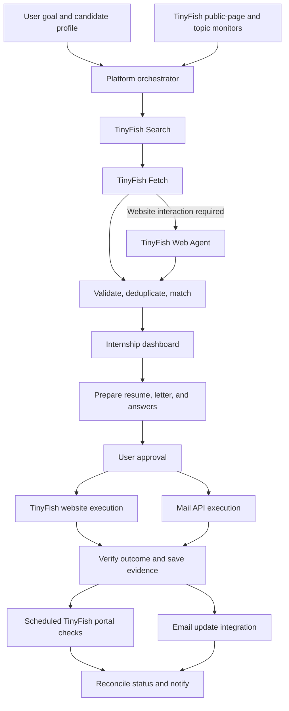

# How TinyFish Will Be Used in the Internship Platform

> Proposed integration guide, based on official documentation checked on 14 October 2026. Request examples are illustrative and have not been executed. Replace example URLs with supported target sites.

## 1. TinyFish’s Role

TinyFish will provide the platform’s **web interaction layer**. It will help discover internship pages, read listings, navigate websites, execute approved application workflows, and check employer portals.

The platform’s own orchestrator will decide what work to perform and when. TinyFish will carry out bounded web tasks and return observations that the backend validates and stores.

For example:

> User goal: Find paid remote Python internships, prepare suitable applications, and track employer responses.

The platform breaks this goal into discovery, extraction, matching, document preparation, submission, and tracking. TinyFish handles the website-facing tasks within that workflow.

## 2. Feature-to-Capability Mapping

| Project feature | TinyFish capability | Responsibility of our application |
|---|---|---|
| Keyword-based internship discovery | Search API | Generate queries, select sources, merge results. |
| Read internship descriptions | Fetch API | Extract business fields, validate them, store evidence. |
| Navigate search filters and pagination | Web Agent API | Supply a scoped goal and consolidate returned listings. |
| Prepare and submit website applications | Web Agent API or Browser API | Approve the exact application package and verify the result. |
| Research companies and recruiting contacts | Search and Fetch APIs | Validate published contacts and compose outreach. |
| Watch public listing changes | Monitor | Interpret changes and notify affected users. |
| Check private application portals | Authenticated Web Agent runs | Schedule checks and reconcile application statuses. |
| Show browser task progress | Streaming Agent endpoint | Forward appropriate progress to the dashboard. |

TinyFish’s API surfaces are described in the [official overview](https://docs.tinyfish.ai/). Public-page and topic monitoring are described in the [Monitor guide](https://docs.tinyfish.ai/monitor).

## 3. Overall Integration Flow



## 4. Internship Discovery

### Search for candidate URLs

Our Discovery Agent turns preferences into queries such as:

- `remote Python backend internship paid`
- `software engineering internship India students`
- `machine learning internship company careers`

Use TinyFish Search to obtain candidate URLs. Search results are leads; the platform must verify that the listing is still open and suitable.

Illustrative request:

```http
GET https://api.search.tinyfish.ai?query=remote%20Python%20internship%20paid&language=en
X-API-Key: <server-side-key>
```

The API also supports domain inclusion/exclusion parameters, which can help restrict discovery to chosen sources. See the [Search API reference](https://docs.tinyfish.ai/search-api/reference).

### Navigate sites when needed

If the desired listings require on-site search, filters, or pagination, invoke a Web Agent task for that source.

Example goal designed by our application:

```text
Search this website for Python backend internships.
Use the available remote-work filter.
Inspect at most three result pages and return at most ten listings.
For each listing return the title, company, listing URL, and visible
stipend and deadline text. Mark missing information as unknown.
Do not apply, send messages, or change account settings.
Stop and report the obstacle if access requires user intervention.
```

This uses bounded exploration. The page and listing limits are goal instructions; the backend should also enforce concurrency and runtime budgets.

## 5. Read Listings and Build Dashboard Records

Fetch a known listing URL to obtain content for our extraction and matching steps.

```http
POST https://api.fetch.tinyfish.ai
X-API-Key: <server-side-key>
Content-Type: application/json
```

```json
{
  "urls": ["https://careers.example.com/internships/backend-123"],
  "format": "markdown",
  "links": true,
  "ttl": 0
}
```

`ttl: 0` requests a live fetch. Fetch accepts up to ten URLs per request and reports individual failures in `errors[]`; process successful results even if another URL fails. See the [Fetch API reference](https://docs.tinyfish.ai/fetch-api/reference).

The backend converts the content into its own record. This example is our proposed application schema, not a TinyFish response contract:

```json
{
  "company": "Example Company",
  "role": "Backend Engineering Intern",
  "work_mode": "remote",
  "location": "India",
  "required_skills": ["Python", "FastAPI"],
  "stipend_amount": 20000,
  "stipend_currency": "INR",
  "stipend_period": "month",
  "deadline": null,
  "deadline_timezone": null,
  "deadline_raw_text": "Not specified",
  "source_url": "https://careers.example.com/internships/backend-123",
  "application_url": "https://careers.example.com/apply/backend-123"
}
```

Add retrieval time and evidence passages in storage. Deduplicate listings before showing them. Keep unknown pay and deadlines visible, normalize payment periods for comparisons, and let users sort by pay, deadline, or fit.

If interaction is needed to reveal the details, use Web Agent extraction. TinyFish supports an `output_schema` field using a documented schema subset; validate the returned data again in the backend. See [Structured Output](https://docs.tinyfish.ai/key-concepts/structured-output).

## 6. Resume and Cover-Letter Preparation

TinyFish supplies the job description and relevant company information. Our Application Preparation Agent uses those observations together with verified candidate experience to produce:

- A tailored resume.
- A role-specific cover letter.
- Screening-question answers.
- A list of missing facts that need user input.

This is a **RAG** workflow: retrieve relevant candidate evidence, then generate grounded documents. Document generation and factual checking are responsibilities of our platform.

## 7. Applying Through Websites

### Prepare before execution

1. Inspect the supported application flow and identify required fields.
2. Assemble the exact candidate answers and document versions.
3. Show the application package for review.
4. Record approval against that version and destination.
5. Invoke the submission workflow only after the backend validates approval.
6. Capture and verify confirmation evidence.

TinyFish documents basic and multi-step [form filling](https://docs.tinyfish.ai/examples/form-filling). Validate file uploads, screening questions, login requirements, and confirmation behavior separately on each supported site.

### Execute the approved workflow

Example execution goal, constructed only after approval:

```text
Apply to the internship at the specified application URL using
the approved candidate answers supplied with this task.
Do not invent answers. Stop if a required answer is missing,
the role or destination differs from the approved application,
or authentication needs user intervention.
Submit this approved application once and return the visible
confirmation message and application reference, if available.
If the outcome is uncertain, report that uncertainty.
```

For precise control over individual actions, use TinyFish Browser with a controller such as Playwright/CDP. This allows the controller to place the final submission action behind an application-level approval check. See [TinyFish Browser](https://www.tinyfish.ai/browser).

A natural-language stop instruction alone is not an enforceable approval boundary. Keep execution permissions in the backend and use a controlled browser flow or manual final submission where a hard boundary is required.

### Verify submission

A successful automation run describes the task’s execution outcome. The application still needs evidence that the employer received the application: a confirmation page, application ID, receipt email, or portal record.

If the connection fails after a possible submission, inspect the employer record before retrying. An internal lock cannot guarantee exactly-once behavior on an external website.

## 8. Email Applications and Cold Outreach

TinyFish can help find published recruiting contacts and research company context. Our Outreach Agent prepares the message and supporting documents.

Use an authorized mail integration for sending and receiving messages. Keep these activities distinct:

| Activity | Dashboard meaning |
|---|---|
| Email sent to a published application address | Email application sent; delivery and employer acknowledgment are separate evidence. |
| Cold email sent to ask about opportunities | Outreach sent. |
| Employer confirms receipt of an application | Application acknowledged. |

Store recipient, thread/message identifiers, application association, and approval version. Stop follow-ups when the employer replies or the user disables them.

## 9. Monitoring Listings and Applications

### Public listings

Use TinyFish Page Monitors for known public listing URLs and Topic Monitors for recurring searches. Topic changes identify new result URLs; page changes compare extracted content. See the [Monitor documentation](https://docs.tinyfish.ai/monitor).

Our backend interprets whether a change matters: a listing closed, its deadline moved, or a new matching role appeared. Filter unchanged or irrelevant events before notifying users.

### Private application portals

Use scheduled authenticated Web Agent tasks, with a browser context mapped to the correct user and account. TinyFish [Browser Context Profiles](https://docs.tinyfish.ai/key-concepts/browser-context-profiles) preserve cookies and storage across runs; login sessions can still expire or require MFA.

Example read-only goal:

```text
Open the application-status page for the supplied application
reference. Return the exact visible status and any next-action
deadline. Do not submit, withdraw, edit, or message anyone.
If the application cannot be identified or login has expired,
report the issue instead of guessing a status.
```

Public-page monitoring and authenticated portal checks are different integration paths.

### Employer email and reminders

Use mailbox events through the mail provider, then let the Response Agent classify the message and link it to the correct application. For example, [Gmail push notifications](https://developers.google.com/workspace/gmail/api/guides/push) can notify the backend of mailbox changes.

The platform’s scheduler handles reminders such as “deadline tomorrow” and “interview in two hours.” TinyFish checks the web; our services manage the user’s notification schedule.

## 10. Agent Requests, Progress, and Background Runs

| Endpoint | Proposed use |
|---|---|
| `POST /v1/automation/run-sse` | User-triggered tasks with live progress. |
| `POST /v1/automation/run-async` | Background discovery and portal checks. |
| `POST /v1/automation/run` | Small synchronous tasks when cancellation is unnecessary. |

These paths use `https://agent.tinyfish.ai`. See [Agent Endpoints](https://docs.tinyfish.ai/key-concepts/endpoints).

Illustrative read-only background request:

```json
{
  "url": "https://careers.example.com/internships/backend-123",
  "goal": "Read this internship listing. Return its company, title, visible stipend text, visible deadline text, eligibility requirements, and application URL. Report missing values as unknown. Do not apply or send messages.",
  "agent_config": {
    "max_duration_seconds": 180
  },
  "webhook_url": "https://your-platform.example.com/webhooks/tinyfish"
}
```

For authenticated runs, the request can include `use_profile: true` and the correct `profile_id`. The backend must resolve that profile from the authenticated user’s account mapping.

Keep the API key on the server. Record the returned `run_id` with the internal task. If an Agent SSE connection drops, poll `GET /v1/runs/{run_id}` rather than assuming the run stopped or starting a duplicate. Some options, including strict mode, step limits, and capture features, require account enablement. See the [Agent API reference](https://docs.tinyfish.ai/agent-api/reference).

### Webhook processing

Run webhooks report completion, failure, or cancellation. A webhook receiver should persist the event, acknowledge quickly, and process it through a worker. For sensitive changes, retrieve the run from TinyFish before trusting callback data. See [Webhooks](https://docs.tinyfish.ai/webhooks).

Proposed worker logic:

```text
Receive event → Persist and acknowledge → Check known run ownership
→ Retrieve authoritative run → Validate result → Apply state update once
→ Notify only if the change is meaningful
```

An internship application should maintain separate fields for automation state, submission verification, employer status, and last-checked time. A failed status check must not overwrite a previously verified employer status.

## 11. Agent Tools Exposed by Our Backend

These names describe our proposed tool wrappers, not built-in TinyFish API methods:

| Proposed tool | Backing capability |
|---|---|
| `discover_internship_urls(query)` | TinyFish Search |
| `read_listing(url)` | TinyFish Fetch |
| `inspect_source_listings(source, filters)` | TinyFish Web Agent |
| `execute_approved_application(application_id)` | TinyFish Web Agent or controlled Browser flow |
| `check_application_status(application_id)` | Authenticated TinyFish Web Agent |
| `watch_public_listing(url)` | TinyFish Monitor |

Each wrapper validates inputs, applies permissions and budgets, records run ownership, and returns a consistent application-level result. This forms part of the **agent harness** around TinyFish.

## 12. Reliability and Evaluation

- **Bounded execution:** cap concurrent jobs, task duration, result counts, and retries.
- **Grounding:** retain source URLs and observation timestamps; distinguish unknown facts from verified facts.
- **Idempotency:** deduplicate callbacks and lock application execution; reconcile uncertain external outcomes before retrying.
- **Context isolation:** map profiles to users server-side and keep credentials outside prompts and general memory.
- **Untrusted content:** treat page text and employer messages as data, not instructions to change agent permissions.
- **Failure recovery:** back off on rate limits; surface expired logins, access blocks, or missing facts as actionable tasks.
- **Observability:** track run duration, failures, resource usage, extraction completeness, and confirmation evidence.

Evaluate the integration against known examples: correct deadline/pay extraction, duplicate detection, form-field accuracy, submission receipts, and portal-status interpretation. A successful browser run alone is not an adequate quality metric.

## 13. MVP Implementation Order

1. **Search and read:** discover URLs, fetch descriptions, and populate the dashboard.
2. **Interactive discovery:** support one source that requires browser navigation.
3. **Application execution:** implement one tested flow, reviewed documents, and verified outcomes.
4. **Tracking:** add one authenticated portal check and one mail integration.
5. **Monitoring:** add public listing watches, deadline reminders, and meaningful-change notifications.

The demonstration should show TinyFish performing observable web work: discovering a listing, extracting evidence, executing an approved application, and checking its later status. The platform connects those actions into a persistent internship workflow.
